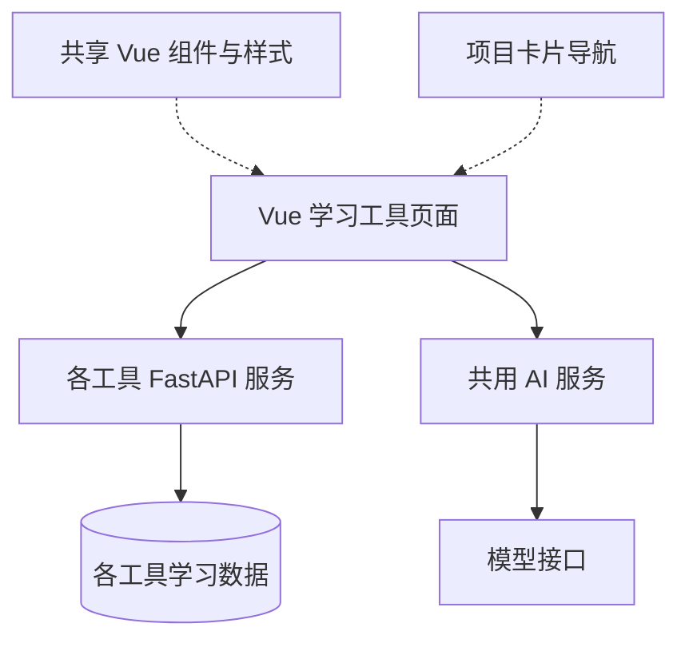

# AI 学习工具集

[返回项目索引](https://github.com/18538205298/project-portfolio)

## 项目概览

将学习记录、知识卡片、学习包、题库与进度统计拆成多个工具，共用 AI 服务和部分界面组件。适合展示从学习需求到可维护 Web 应用的组织方式。

**技术栈**：Vue 3、TypeScript、Vite、Element Plus、FastAPI、SQLModel、SQLite。

## 工具组成

| 工具 | 功能 |
| --- | --- |
| 知识地图与学习包 | 按知识结构组织学习内容与进度 |
| 题库与问答练习 | 抽题自测、模拟问答与来源标注 |
| 视频学习记录 | 视频笔记和学习记录 |
| 阅读学习记录 | 书籍、论文与博客学习记录 |
| 知识卡片 | 学习笔记、知识卡片与题目关联 |
| 学习统计 | 学习时间、进度与经验值汇总 |
| 共用 AI 服务 | 分场景提示词、回答评判与流式对话 |
| 共享界面与导航 | 页面框架、聊天面板、Markdown 展示与项目卡片导航 |

## 结构概览

这是模块关系的示意图，具体部署与接口调用方式以对应工具实现为准。

## 技术要点

- 学习记录、内容和进度如何分开组织。
- 多个小工具如何复用组件和 AI 能力。
- AI 评判与人工判断如何配合。
- 题目和学习材料如何标记来源。
- 数据库、接口、视图和组件如何划分。

## 内容与归属

题目、论文、教程及课程资料归原作者。共享组件中的主题样式包含第三方改编内容，使用时遵循对应许可。这里展示工具功能与结构，知识库原文和用户学习数据保留在本机。

## 关键代码

- `samples/progress_service.py`：来自原项目 `study-quest/backend/app/services/progress_service.py`。
- `samples/chat_service.py`：来自原项目 `ai-service/backend/app/services/chat_service.py`。
- `samples/PageShell.vue`：来自原项目 `my-ui/src/components/PageShell.vue`。

这些文件保留原项目中的核心逻辑，供阅读和交流。完整应用还包含其余模块、依赖与运行配置。
